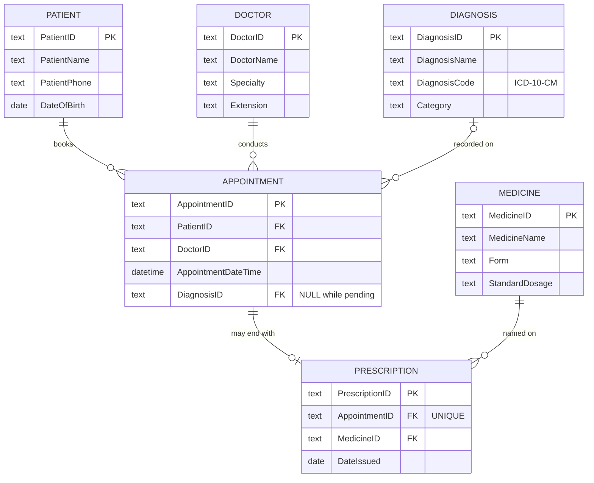

# From Business Rules to a Working Database: University Wellness Clinic

A small university wellness clinic kept every appointment as one row of a paper-style record. This project turns that record into a normalized relational database (Third Normal Form), implements it in SQLite, and proves with automated checks that the anomalies in the original record can no longer happen.

**Skills:** business rules and requirements, data modeling (ERD), normalization to 3NF, SQL, data quality, Python

## The problem

The clinic's record looked like this:

| Patient | Phone | Doctor | Appointment | Diagnosis | Medicine |
|---|---|---|---|---|---|
| P101 Maya Chen | 555-0101 | D07 Dr. Ortiz | A501, Sep 3, 9:00 | Migraine | Sumatriptan |
| P101 Maya Chen | 555-0199 | D12 Dr. Singh | A548, Sep 21, 2:00 | Allergy | Cetirizine |
| P204 Omar Ali | 555-0144 | D07 Dr. Ortiz | A566, Sep 24, 11:00 | Migraine | Sumatriptan |
| P330 Lina Park | 555-0170 | D12 Dr. Singh | A590, Oct 2, 1:30 | Pending | None |

Three problems were already visible:

- **Update anomaly:** Maya Chen has two different phone numbers, because her number is copied into every visit and only one row was updated. Nobody can tell which number is current.
- **Insertion anomaly:** a walk-in student cannot be registered until a visit is booked, and a new drug cannot enter the formulary until it is prescribed.
- **Deletion anomaly:** cancelling Omar Ali's only visit would also erase his name and phone number.

## Business rules

1. One patient may have zero or many appointments; each appointment belongs to exactly one patient.
2. One doctor may conduct many appointments; each appointment is assigned to exactly one doctor.
3. A patient may exist before booking anything; an appointment cannot exist without both a patient and a doctor.
4. After a visit, an appointment has zero or one diagnosis and zero or one prescription. One medicine may appear on many prescriptions; each prescription names exactly one medicine.

## Data model



### Key design decisions

- **Every fact lives in one place.** Patient contact details sit in `Patient`, diagnosis names in `Diagnosis`, drug details in `Medicine`. Visits point to them by key instead of copying them.
- **Removing the transitive dependency.** The first draft kept the diagnosis name in the appointment row. Testing it against 3NF showed `AppointmentID → DiagnosisID → DiagnosisName`: the name is a fact about the diagnosis, not the visit, and would be retyped on every visit with the same condition. Moving it to its own table fixed that and gave a clean way to record pending cases as `NULL` instead of loose text.
- **`Prescription` resolves the many-to-many link** between appointments and medicines. A `UNIQUE` constraint on `AppointmentID` enforces the one-prescription-per-visit rule; if the clinic later allows several drugs per visit, dropping that constraint is the only change needed.
- **Surrogate key for `Appointment`,** because the same patient and doctor can meet more than once.
- **Validation in the schema, not just the app:** foreign keys, ID formats (`P101`, `D07`, `A501`), and real dates are all enforced by `CHECK` constraints.

## What the database can now answer

Results from `python run.py` (full output in [`docs/results.md`](docs/results.md)):

**Pending cases worklist** (visits still waiting for a diagnosis, as of Oct 27, 2026)

| Appointment | Patient | Doctor | Visit | Days open |
|---|---|---|---|---|
| A590 | Lina Park | Dr. Singh | 2026-10-02 13:30 | 24 |
| A634 | Daniel Reyes | Dr. Moreau | 2026-10-19 10:00 | 7 |
| A649 | Lucas Martin | Dr. Moreau | 2026-10-23 08:30 | 3 |

**Doctor workload and documentation rate**

| Doctor | Specialty | Visits | Diagnosed | Diagnosed % | Prescriptions |
|---|---|---|---|---|---|
| Dr. Ortiz | General Practice | 6 | 6 | 100 | 6 |
| Dr. Singh | Family Medicine | 5 | 4 | 80 | 3 |
| Dr. Moreau | Sports Medicine | 4 | 2 | 50 | 2 |
| Dr. Okafor | Dermatology | 3 | 3 | 100 | 3 |

Other queries cover the visit log, the most common diagnoses, prescriptions by medicine (including drugs never prescribed), returning patients, and registered students who have not visited yet.

## Proof that the anomalies are gone

`tests/test_integrity.py` runs 12 checks against a fresh database, including:

- updating Maya Chen's phone once changes it for every one of her visits
- a patient and a medicine can each be added on their own
- cancelling a visit keeps the patient and the diagnosis list, and removes only that visit's prescription
- an appointment for a patient or doctor who does not exist is rejected
- a second prescription for the same visit is rejected
- malformed IDs and dates are rejected

## Run it

Requires Python 3.9 or later; SQLite ships with Python.

```bash
python run.py                         # builds clinic.db and prints every query result
python -m unittest discover tests     # runs the integrity checks
```

## Project structure

```
sql/01_schema.sql     tables, keys, constraints, indexes
sql/02_seed.sql       the original four records, normalized, plus illustrative sample records
sql/03_queries.sql    the questions the clinic can now answer
run.py                builds the database and runs the queries
tests/                integrity checks for every business rule
docs/results.md       query output
```

## About the data

The four original records come from the case. Every other person, visit, and prescription is fictional sample data, added so the queries return meaningful results. Diagnosis codes are standard ICD-10-CM codes; dosages are typical label strengths, for illustration only.

## Credits

Designed as a two-person team project at Alliant International University (Database Design Principles and Technologies, August 2026).

- **Emma Larroze:** facilitation, business rules, entity inventory, SQL, and this SQLite implementation with its tests
- **Marina:** anomaly analysis against the paper record, table definitions, relationship mapping, and the design quality review
